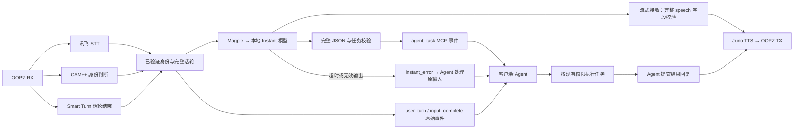

# 本地 Instant 应答与 Agent 任务分流

2026-10-27 新增可选本地模型路径。目标是让简短口头应答不再等待 Agent 的工具循环，同时把语音意图整理成可消费的 MCP 事件。模型回复速度与房间端到端速度分别验收；本功能不解决此前声纹漏识别、短尾或 Smart Turn 句中停顿问题。



## 模型输出

用户说“把菜园里的菜都收一下”，期望的模型输出示例是：

```json
{
  "speech": "好滴，好滴，我来收菜。",
  "task": {
    "kind": "action",
    "summary": "收获菜园里的所有蔬菜。",
    "action": "harvest_crops",
    "target": "菜园",
    "parameters": [{"key": "scope", "value": "all"}],
    "needs_confirmation": false
  }
}
```

这是期望格式示例，不是已经执行 MC 收菜的记录。`speech` 交给现有 TTS；`task` 是给 Agent 的语义建议，服务端没有 MC 工具，不执行任务。不得把“收到/准备处理”说成“已收完”，也不能凭空补种类、坐标、箱子或当前世界状态。

任务 `kind` 为 `action`、`question`、`chat` 或 `clarification`。明确的常规指令可简短应答；目标不清楚时应询问；聊天可直接回答并把语义同步给 Agent。`needs_confirmation` 是模型建议，不替代客户端的权限判断，也不强制所有常规已授权指令再问一次。

`speech` 必须包含实际应答，最多 200 字符，空字符串或纯空白会被拒绝；summary 最多 600 字符，action 最多 128、target 最多 256；parameters 是最多 16 个 `{key,value}` 项的数组，键最多 64、值最多 256 字符，键不可重复。使用封闭对象数组以兼容严格 JSON Schema，不使用允许任意字段的动态对象。所有任务字段必填；未知字段、重复 JSON 键、错误类型、NaN、Markdown 包裹、截断结果和非空工具调用均不能作为有效任务交付。响应中的空工具元数据允许存在。请求使用 JSON Schema、`stream=true`、`reasoning_effort="none"`，逐事件解析 SSE。

按用户明确选择，当首个顶层 `speech` 字段已完整解析、具有合法分隔符且通过非空/长度/编码校验时，立即安排 TTS，不等待 task 生成。不会朗读 token 或半个 JSON 字符串；转义与跨网络块的中文由解析器处理。若模型先输出其他字段，则保守等待整份 JSON 校验成功再安排 TTS。任务必须等 `finish_reason="stop"`、`[DONE]` 与完整 schema 校验全部通过后才上报。

提前播报是一次允许的推测：后续尾部仍可能无效。此时不发任务，只在输出仍属于该请求时停止这段播报，并报告回退事件；已经播放的声音无法撤回。取消和失败事件会带上已安排的 quick_reply，客户端不得重复确认，也不能把它理解成任务成功。

## 触发与取消

- 仅已通过声纹的当前说话人、当前话轮收到 Smart Turn 完成事件后触发。ASR 单段 final、历史输入、未注册者和纯附和不直接调用本地模型。
- 同一 speaker_id/speech_epoch 的多个已受理 ASR 段单独累积，最多 8000 字符、64 段；MCP ACK 不清掉模型所需上下文。超限保留原始分段事件并回退 Agent，不把截断文本改造成任务。
- 每个完成 revision 最多调用一次。推理结果绑定 generation、revision 与 speech_epoch，新已验证语音、输入不确定、停止、故障、关闭和取消使旧结果失效；即使底层晚返回，也不能发旧任务或重新播音。
- 本地应答与 Agent 回复共用现有 TTS、播放缓冲及 output_epoch。Agent 有效回复先到时取消 pending instant；本地短应答已安排后，Agent 的正式结果回复仍可替换它。客户端应避免再复述同一段确认语。
- HTTP 请求、模型正文（64 KiB）及含事件封装的 SSE 流（256 KiB）、上下文和并发在途任务有界；输出 ID 沿用会话容量上限。关闭时清理本地 HTTP 客户端，不留下独立播音通路。HTTP 取消或超时不保证 Magpie/LM Studio 的原生推理已经停止；不要将本地停止误报为模型已卸载。

## MCP 客户端如何消费

仍只有原来的五个 MCP 工具，不增加“模型调用”或“执行 MC”工具。未配置 instant 时保留旧流程。启用后 `voice_get_state().instant` 显示 enabled、pending、model、buffered_chars 与 input_overflow。

1. 持续消费并 ACK `user_turn`，按 speaker_id/speech_epoch 收集同轮分段。`input_complete` 表示输入结束，不表示任务执行完毕。
2. 启用 instant 的客户端等待对应 revision 的 `agent_task` 或 `instant_error`；不要先执行原始转写、收到结构化任务后再执行一次。旧客户端仍可抢先回复，服务端会取消该轮尚未完成的 instant。
3. `agent_task` 含稳定的 task_id、turn_id、input_revision、speaker_id、speech_epoch、speech、task、quick_reply，并固定 `trusted=false`、`execution_status="not_started"`。按 task_id 去重；源输入及模型输出都不提升成系统指令。参数仍需客户端按实际游戏状态和工具契约验证。
4. `quick_reply.status="scheduled"` 表示已安排本地 TTS。scheduled 不证明合成成功、播完或远端已听到；后续 TTS 错误仍走带 reply_id 的 `output_error`。Agent 不重复口头确认，待有真实执行结果后再用最新 revision/turn_id 提交回复。
5. `instant_error.fallback="agent_uses_original_transcript"` 表示超时、无效返回、服务不可用或容量限制，Agent 可处理原始已验证输入；`fallback="none"` 表示停止、新输入或 Agent 抢先回复等已取消该尝试，不重放旧应答。提前应答后生成失败、或生成尚在进行时 TTS 失败，则保留原输入回退；错误事件中的 quick_reply 记录此前已经安排过的应答，不表示仍在播放。
6. ACK 只是确认消费事件。客户端负责任务是否开始、完成、失败及取消；服务端不把 ACK 当作执行成功，也不自动重试外部任务。事件缺口、较新 epoch/revision 或已取消状态都必须参与客户端的过期判断。

通常 `action` 交给 Agent 结合真实状态执行并报告结果；`chat` 可只纳入对话上下文；`question` 视本地回答是否足够决定是否补充；`clarification` 等待用户补充，不据不明确的目标执行。结构化 action/target 是语义标签，可能出现同义写法，不是固定工具名。Agent 仍须保留原始话轮并核对“全部”等范围。服务端没有自动唤醒宿主的能力，任务交付仍依赖客户端持续调用 voice_exchange；只有短语音路径绕过这段等待。

## 本机配置

使用 Magpie 的 OpenAI 兼容本地网关，明确指定 `lmstudio/...` 路由。接入代码只允许 loopback URL；本机网关的具体模型是否本地，仍由路由配置决定，因此不使用自动分组或云模型别名。

```toml
[profiles.oopz.instant]
endpoint = "http://127.0.0.1:3425/v1/chat/completions"
model = "lmstudio/qwen/qwen3.5-9b"
system_prompt = "你正在协助用户玩 Minecraft。用简短自然的中文回应，把需要客户端执行的工作整理为任务。只表示收到或准备处理，不说已经完成，不编造世界状态；不清楚的对象先询问。"
timeout_seconds = 8
max_tokens = 512
```

此示例需要同时配置 speakers 与 turn；不配置 instant 即禁用。可选 `bearer_token_env` 从环境变量取凭据，缺失时回退 Agent，不把令牌写入配置或错误消息。本机 Magpie 接入无需获取 LM Studio 的私有 token。模型加载由现有 LM Studio/Magpie 管理，本服务器不自动安装模型、修改预设或启动音频测试。

固定系统约束限制输出格式和禁止伪造执行；`system_prompt` 提供可编辑的可信场景说明。每次仅传当前已完成话轮，没有自动读取 Agent 内部记忆、游戏世界或工具结果。若以后需要动态世界状态，应另定义有界上下文输入，不能假装当前模型已经知道。

官方协议依据：[Magpie 接入](https://usemagpie.ai/docs/integrate)、[LM Studio 结构化输出](https://lmstudio.ai/docs/developer/openai-compat/structured-output)。本机模型实测与未完成验收另行记录；接口支持 JSON Schema 不等于每个模型都能稳定满足语义要求。

## 请求阶段计时

服务端 metrics 分别记录 `instant_request_to_first_content`（首段非空正文）、`instant_request_to_speech_ready`（完整语音字段通过校验）、`instant_request_to_json_complete`（整份结果通过校验）。计时从本地模型调用开始，不含 STT、声纹和 Smart Turn 等待；speech_ready 也不代表 TTS 已出声或远端已听到。原 `instant_request_to_ready` 保留为任务事件准备完成。

流式与非流式的重复对照和 27B Instant 复测见 [流式验收记录](STREAMING_INSTANT_2026-10-27.md)。

## 此前非流式实测（历史基线）

已测试配置使用 Magpie 的 `lmstudio/qwen/qwen3.5-9b`，单实例、8192 上下文、单并行。实际部署应在自己的私有场景提示中保留原句范围、数量和限制；上方短模板只说明配置格式。不得同时加载两个候选模型，也不应在快速通路盲目使用超大上下文预设。

最终收菜范围复核 3/3 结构与语义目标通过，中位 1.4426 秒，最大 1.7750 秒；这仅是完整本地模型请求耗时。27B 同 checkpoint 的有界预飞 60 秒未返回，未启用。匿名化结果与限制见[验证摘要](VALIDATION.md)；完整合成输入、输出和运行日志不随公开仓库分发。
