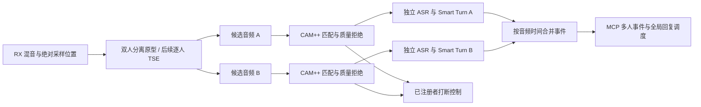

# 已注册多人同时讲话的语音分离研究

研究日期：2026-10-24（Asia/Shanghai）。本文件是独立研究结果，不代表分离功能已经实现。只读取现有代码和公开的一手资料；未安装模型、下载权重、连接房间或测试真实音频。当前主线仍是 CAM++ 多人注册、未注册者不触发回复/打断、Smart Turn 话轮结束判断；延迟优化继续暂缓。

**结论：需要在 ASR 前恢复每个人的独立音频，再分别识别和判断话轮。CAM++、说话人分段（diarization）和 Smart Turn 都不能代替这一步。** 对当前 16 kHz 单声道房间混音，近期可复现的首选原型是 **MossFormer2_SS_16K 双人分离 → CAM++ 全局身份匹配 → 每人独立讯飞流与 Smart Turn**；长期更符合注册名单的结构是**按注册者做目标说话人提取（TSE）**。二者都需要本机及中文 OOPZ 条件验证，不能直接承诺任意人数、稳定实时或完全消除串音。

## 先区分音频来源

| 场景 | 更合适的处理 |
|---|---|
| A、B 用各自 OOPZ 账号和麦克风同时说话 | 如果能通过受支持的接入取得每个远端账号的独立音轨，优先保留独立音轨，避免先混再分。 |
| 同一个麦克风同时录到 A、B | 即使有账号独立音轨，该音轨内部仍是混音；需要分离/TSE。账号 ID 也不等于现场人的声纹身份。 |
| 当前 BlackHole RX 已经收到房间混音 | 左右声道没有天然对应用户；现有 `_capture` 还会取声道平均。增加虚拟声卡不能凭空恢复用户轨道。 |

Agora Web SDK 官方提供按远端用户订阅音轨、获取用户 ID、通过 `setAudioFrameCallback` 取得该轨 PCM 的能力。这说明“在受支持的应用层保留多轨”技术上成立，**不证明 OOPZ 已开放这些对象或第三方加入权限**。本轮没有找到并验证 OOPZ 官方提供的逐用户音频导出/机器人语音 SDK；搜索结果里的第三方 SDK 不能当作官方承诺。若未来采用此路，需单独确认 OOPZ 支持的接入方式及账号/轨道生命周期，不以抓取令牌或依赖网页内部对象作为默认方案。[Agora 订阅接口](https://api-ref.agora.io/en/video-sdk/web/4.x/interfaces/iagorartcclient.html#subscribe)、[远端音轨 PCM 接口](https://api-ref.agora.io/en/video-sdk/web/4.x/interfaces/iremoteaudiotrack.html#setaudioframecallback)

## 两种真正分离的方法

| 方法 | 输入和输出 | 适配已注册多人 | 主要代价/风险 |
|---|---|---|---|
| 盲语音分离 + 注册匹配 | 一段混音 → 固定数量的匿名波形；然后用 CAM++ 认人 | 可以直接复用当前 CAM++ 注册库，不需要改变分离模型 | 输出顺序会交换；人数不符、单人时的伪第二路、两路都认成同一人、串音均需处理。 |
| 目标说话人提取 TSE | 混音 + 某人的注册参考 → 该人的估计波形 | 对每个候选注册者运行一次，天然以目标 ID 命名输出 | 目标没讲话时仍可能漏出别人；推理成本随同时跟踪目标数增加；需要模型自己的注册特征。 |
| 仅 diarization / 声纹标签 | 混音 → 谁在何时说话的标签 | 能辅助检测重叠、确定候选者 | 不输出分开的波形，不能保证两个人同时说的不同句子都被 ASR 识别。 |

TSE 的输入条件是经过训练的特征空间。**CAM++ 向量不能直接替代 ECAPA、d-vector 或 SpEx+ 内部编码器输出**；维度相同也不意味着语义空间兼容。未来可以在同一次经确认的注册采样中，在内存里分别生成 CAM++ 身份特征和所选 TSE 的条件特征，各自保存模型标识与哈希，再丢弃原始录音。只有 CAM++ 向量而没有录音的旧注册库，通常需要重新采样才能生成另一模型的特征。不要为尚未选定的 TSE 现在就增加多个模型或保留录音。

并行 TSE 也不是“注册 N 人就可靠分离 N 人”：模型训练的混合人数、目标缺席表现及输出串音决定可用范围。不能把逐人提取的结果再用简单波形相减递归获得其他人；幅相误差会积累。

## 已核查的候选

| 候选 | 可确认的能力、权重与依赖 | Mac / 中文 / 流式判断 | 建议 |
|---|---|---|---|
| **ClearerVoice MossFormer2_SS_16K** | 官方 16 kHz 双输出权重约 670 MB，模型卡 Apache-2.0；Python/PyTorch/TorchAudio，完整 ClearVoice 包还带视频等依赖。 | 官方代码在检测到 MPS 时仍选 CPU；当前推理配置为 2 秒解码窗口，属于分段处理，不能称为现成有状态低延迟流式接口。公开表格覆盖英文来源混音；中文 OOPZ 未验证。 | **最先建立双人功能基线**，后续在独立环境验证 CPU 可运行和质量。先不优化窗口或移植 Core ML。 |
| **REAL-TSE BSRNN，`spk_emb_causal_100`** | 官方提供 16 kHz 因果/非因果四种基线和权重入口；固定 ECAPA 条件的版本更容易缓存注册特征。PyTorch/TorchAudio + 固定版本 WeSpeaker。 | 官方挑战含普通话与英语真实会议；基线本身训练于英语 Libri2Mix。公开 `evaluate.py` 是文件输入，支持 CPU，但未在本轮确认可直接复用的连续状态 API。需要处理 STFT、LSTM 状态、时间轴与末尾 flush。 | **长期 TSE 的优先技术候选**；先核实权重许可、加载依赖和流式状态接口，再决定生产接入。 |
| **ClearerVoice SpEx+** | 官方有音频参考条件的预训练权重，模型卡 Apache-2.0；WSJ0-2mix、8 kHz、非因果。 | 只能作为离线 TSE 对照；会降低当前 16 kHz 信息带宽。非因果不能通过更小切块自动变成可靠因果模型。 | 可做比较，不作为当前首选。不要把 AV_MossFormer2 的视频条件模型误当纯音频声纹模型。 |
| **SpeechBrain SepFormer** | `sepformer-whamr16k` 为 16 kHz 双路，`sepformer-libri3mix` 为 8 kHz 三路；各有公开 Apache-2.0 模型卡。依赖 SpeechBrain/PyTorch/TorchAudio。 | 官方接口是文件/批次分离，中文与 Mac 实时吞吐没有当前证据。三路模型证明三人基线可获得，不证明多人无限扩展。 | 双路或三路的比较基线。3+ 人不得套用双人检查点并宣称支持。 |
| **Look Once to Hear** | 原论文与官方代码是真实流式 TSE 研究；使用双耳声学条件，许可仅非商业用途。 | 论文嵌入式 CPU 结果属于它的硬件和双耳条件，不能外推到这里的单声道 OOPZ。 | 了解流式设计，当前不直接采用。 |

MossFormer2 的范围和复现入口：[官方模型卡](https://huggingface.co/alibabasglab/MossFormer2_SS_16K)、[权重文件](https://huggingface.co/alibabasglab/MossFormer2_SS_16K/tree/main)、[双输出 NumPy 示例](https://github.com/modelscope/ClearerVoice-Studio/blob/main/clearvoice/demo_Numpy2Numpy.py)、[解码配置](https://github.com/modelscope/ClearerVoice-Studio/blob/main/clearvoice/clearvoice/config/inference/MossFormer2_SS_16K.yaml)、[设备选择代码](https://github.com/modelscope/ClearerVoice-Studio/blob/main/clearvoice/clearvoice/networks.py)、[依赖定义](https://github.com/modelscope/ClearerVoice-Studio/blob/main/clearvoice/pyproject.toml)。上述 670 MB 是发布文件大小，不是实测运行内存。

REAL-TSE：[官方基线仓库](https://github.com/REAL-TSE/wesep-real-tse)、[CPU 文件推理入口](https://github.com/REAL-TSE/wesep-real-tse/blob/main/evaluate.py)、[挑战基线说明](https://real-tse.github.io/challenge/#baselines)、[论文](https://arxiv.org/html/2607.15198v1)。论文确认因果基线使用单向时间 LSTM 和不跨未来时间的归一化；这与“已提供可即插即用的增量推理状态接口”是两件事。官方基线仓库本轮未找到根 LICENSE 文件，模型包许可尚未核实，不能把新版 WeSep 的 Apache-2.0 自动套给这些检查点。

当前新版 WeSep 官方将 v0.1 标为研究预览，预训练包、CLI 完整验证及 ONNX/C++ 部署仍在路线图中。不能依据旧论文的部署描述，就认定当前分支具备成熟可发布运行时。[官方路线图](https://github.com/wenet-e2e/wesep/blob/master/docs/release_roadmap.md)

其他对照：[SpEx+ 官方训练/模型说明](https://github.com/modelscope/ClearerVoice-Studio/blob/main/train/target_speaker_extraction/README.md)、[SpEx+ 权重](https://huggingface.co/alibabasglab/log_wsj0-2mix_speech_SpEx-plus_2spk)、[SepFormer 16 kHz 双路](https://huggingface.co/speechbrain/sepformer-whamr16k)、[SepFormer 8 kHz 三路](https://huggingface.co/speechbrain/sepformer-libri3mix)、[Look Once to Hear 论文](https://arxiv.org/abs/2405.06289)、[其许可](https://github.com/vb000/LookOnceToHear/blob/main/LICENSE)。

另有第三方发布的 [REAL-TSE BSRNN Core ML 转换](https://huggingface.co/ferdinandl007/REAL-TSE-BSRNN-CoreML)，它是**非因果 8 秒固定窗口**，不是所需因果版；发布者报告过 M3 Max CPU 测量，但那是发布者在英语/德语样本上的自测。本项目不把它当中文实测或实时保证，其模型卡也明确没有独立上游检查点许可。可作为以后 Apple 部署的技术参考，当前不引入。

## 建议的服务器结构

这是后续架构建议，不要求本轮 CAM++/Smart Turn 实现同步增加这些组件。为避免依赖污染和模型阻塞音频回调，分离原型可放在独立 Python 环境及单个受控工作进程，仍由 MCP 服务统一管理。不要为了研究现在增加网络微服务或另一个聊天模型。

1. **保持共同时间轴。** 输入使用连续 `sample_start/sample_end`；分离输出长度、模型算法延迟、重采样映射都显式记录。不能把静音或被拒绝人的区间删除后，把 ASR 时间直接当原始房间时间。每路保留静音/间隙或明确区间映射；缺帧显式报告，不悄悄补成连续发言。
2. **身份匹配是全局约束。** 盲分离路号不等于 speaker_id。每块对所有注册者算相似度，并结合相邻块重叠音频做排列匹配；同一时段不能让 A/B 两路都无条件认作同一人。低分、候选分差不足、重复路、目标缺席或质量不足时拒绝该路。不能依赖“上一次是谁”强行锁定身份。
3. **分别运行 ASR。** 将两个已分离波形重新混成一条讯飞流会丢掉分离价值；每个可靠说话人有独立识别上下文。需要核查讯飞账户的并发连接额度并设置上限，不在这里假设额度。重叠前后同一人的话要连续，不能每小块重新开启 ASR。
4. **Smart Turn 逐人判断。** A 说完而 B 还说时，只结束 A 的话轮；B 的语音不能被当作 A 的句尾上下文。结果绑定 speaker_id、stream_epoch、turn_epoch 和音频区间，迟到结果不能结束别人的新话轮。
5. **输出保留同时性。** MCP 事件携带说话人、音频起止、独立话轮 ID、分离/身份状态及可选 `overlap_group_id`。按采样时间整理，不按网络返回先后编造对话顺序。全局 input_revision 仍用于拒绝过期回答；TTS 仍只有一条，默认等所有已确认注册者结束或执行明确的抢话策略后回应。
6. **打断权在最后身份门控之后。** 未确认的分离残留、陌生人、两路冲突、讯飞临时文字都不能绕过门控触发回复或暂停 TTS。质量不足只发状态诊断，不自行生成面向陌生人的“请重说”，否则它仍会间接触发回复。有已确认注册者发起的请求无法恢复时，宿主才可请求该人重述。

CAM++ 再验一次有助于减少 TSE 串音，但不能把两套神经网络组合宣称为“陌生人绝对无法通过”。特别要测目标已停止、旁人继续说时是否误保留旁人。分离残留也可能让 Smart Turn 误判语气结束，因此需要在最终链路里验收。

## 分期执行与验收

| 阶段 | 应完成的内容 | 进入下一阶段的证据 |
|---|---|---|
| 当前主线 | CAM++ 多人注册、Smart Turn、身份控制回复和打断 | 单人/轮流讲话与陌生人拒绝测试通过；对无法确认混音保守处理。 |
| 双人分离功能原型 | 固定官方 MossFormer2 权重，在隔离环境实现两路音频与 CAM++ 匹配；先不用真实房间 | 已授权的干净样本混音可复现，能保存原始时间映射；单人、无人、陌生人都不制造假第二人。 |
| OOPZ 双人接入 | 两条独立讯飞上下文、逐人 Smart Turn、事件合并与故障处理 | 已注册 A/B 同时说不同内容能分开；注册者+陌生人场景没有陌生人回复或误打断；失败有明确状态。 |
| TSE 与 3+ 人 | 核实 REAL-TSE 权重许可并验证因果状态接口；决定逐目标 TSE 或三人模型；若 OOPZ 有官方多轨接入则先保留多轨 | 分别验证目标缺席、两人/三人、声线相近、移动/混响、注册失配、长期静默后恢复；不能仅凭双人结果放开人数。 |
| 功能稳定后 | 用户要求的延迟问题一起处理 | 再测总处理吞吐、各路等待、并发 ASR 成本和对话端到端时间。当前不调优或承诺目标毫秒数。 |

功能验收需记录每位说话人的识别字错率、归属错误、漏掉的话、陌生人误接受和误打断。合成混音可用已知干净源计算 SI-SDR；真实房间没有干净参考时，不能伪造 SI-SDR，只能做人工归属/转写核对等评估。先区分“听起来清楚”和“ASR 正确归给对应的人”。

最小故障场景包括：两个输出都匹配 A；A 不说话但 TSE 输出 B；第三人加入双人模型；分离过程落后并填满缓冲；一个 ASR 掉线；先开始的 A 比 B 晚返回 final；A/B 同时结束；模型重载或注册库更新时旧结果返回。遇到超限或模型失败，应标记输入不确定/该路不可用，不把混音当作已确认注册者重新放行。

本研究只新增本文档，没有修改主线依赖、配置、声纹资料或实时音频路径。未完成本机运行、中文 OOPZ 重叠采样和权重完整许可审查；因此近期推荐是双人功能原型，长期方向是受支持的独立音轨加逐目标 TSE，而不是现在就承诺任意多人实时分离。
