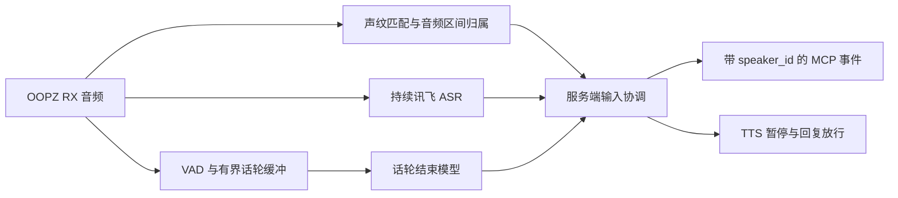

# 服务端多人声纹与话轮结束判断

更新日期：2026-10-28。状态：首版已实现，模型加载与离线回归通过。已有小样本真实测试显示主动打断可以工作，但正常句和短尾仍出现漏识别，整体可靠性未通过，也未完成广泛阈值校准及多注册者验收。匿名化结果见[验证摘要](VALIDATION.md)。

用户确定的规则是**响应已注册的多人**。服务端根据本地声纹判断控制对话事件和打断：被判为未注册或未知的声音不递增输入版本、不触发语音暂停；每位注册者有独立说话人 ID。这一规则受统计识别误差限制，不保证绝对拒绝所有旁人。延迟问题保留现有记录，等待用户认为需要增加的功能完成后再优化。

## 已实现选择与备选

| 功能 | 首版实现 / 研究备选 | 依据与限制 |
|---|---|---|
| 多人声纹注册、匹配与拒识 | 已接入 3D-Speaker CAM++ 中文模型，通过 sherpa-onnx 本地运行 | 固定 ONNX 文件与 SHA-256，多个样本聚合；具体阈值和 OOPZ 麦克风效果尚需实录校准。 |
| 话轮完成/未完成 | 已接入 Smart Turn v3.2 CPU ONNX | 原始音频输入，支持中文，不替换讯飞；复用 16 kHz 单声道 RX，候选静音时判断当前说话人最后最多 8 秒音频。 |
| 四类话轮状态的备选 | ASLP-lab/Easy-Turn | 输出 complete、incomplete、backchannel、wait；更适合后续研究附和和“等一下”。官方实现内部生成转写，部署较重，Mac 尚需验证。 |

CAM++ 的模型与中文训练路线见 [3D-Speaker](https://github.com/modelscope/3D-Speaker)，具体 ONNX 文件见 [sherpa-onnx 官方发布资产](https://github.com/k2-fsa/sherpa-onnx/releases/expanded_assets/speaker-recongition-models)，注册和匹配见 [官方 Python 示例](https://github.com/k2-fsa/sherpa-onnx/blob/master/python-api-examples/speaker-identification.py)。这是部署可行性选择，不是已测得的效果排名。阈值不能直接照搬示例中的 0.6。

Smart Turn 的中文支持与调用方式见 [官方仓库](https://github.com/pipecat-ai/smart-turn)，模型见 [官方模型卡](https://huggingface.co/pipecat-ai/smart-turn-v3)及[权重列表](https://huggingface.co/pipecat-ai/smart-turn-v3/tree/main)。v3.2 权重存放在名称为 `smart-turn-v3` 的仓库中。其推理示例截取末尾最多 8 秒、输出完成概率；集成时必须显式固定 v3.2 文件与版本，不能原样复制仍指向旧文件名的示例。[推理代码](https://github.com/pipecat-ai/smart-turn/blob/main/inference.py)

Easy-Turn 的四类状态与中文示例见 [官方仓库](https://github.com/ASLP-lab/Easy-Turn)和[模型卡](https://huggingface.co/ASLP-lab/Easy-Turn)。它使用语音编码器与语言模型自行生成转写和状态，并不是直接接收“讯飞文字＋音频”的现成双输入 API。官方评测基于 RTX 4090，不能换算成本机速度；本轮未验证其 Mac CPU/MPS 路径。[论文](https://arxiv.org/abs/2509.23938)、[实现](https://github.com/ASLP-lab/Easy-Turn/blob/main/Easy_Turn/wenet/llm_asr/llmasr_model.py)

Smart Turn 的二分类不提供 Easy-Turn 的附和/等待分类。首版沿用并修正现有附和词逻辑，不能描述为已具备这两项模型能力。代码许可分别可查 [3D-Speaker Apache-2.0](https://github.com/modelscope/3D-Speaker/blob/main/LICENSE)、[Smart Turn BSD-2-Clause](https://github.com/pipecat-ai/smart-turn/blob/main/LICENSE)、[Easy-Turn Apache-2.0](https://github.com/ASLP-lab/Easy-Turn/blob/main/LICENSE)。首版模型来源、许可依据、固定版本及 SHA-256 已记录在 [LISTENING_MODELS.json](LISTENING_MODELS.json)。

## 声纹注册和多人规则

注册由本地 `oopz-mcp-speaker` CLI 执行，保留现有五个会话 MCP 工具。当前管理动作是 `enroll/list/remove`；没有自动校准子命令。重新采样需要先删除旧 ID，再注册。模型不能从频道里一句“我是某某”自行注册或更改身份。可复制命令与现场步骤见[本机声纹注册](SPEAKER_ENROLLMENT.md)。

`--record` 从配置指定的 RX 分别录 3 段、每段 8 秒，每段先等待 Enter；只留内存，不连接讯飞或 TTS。也可导入同一人的 3–16 份独立 WAV，每份 2–15 秒、16 kHz 单声道 PCM16。注册检查静音、削波、重复样本和嵌入一致性，但不能可靠识别所有混人样本；仍需现场确认只有本次注册者讲话。

服务端保存 `speaker_id`、显示名称、归一化声纹向量、模型指纹和特征维度，阈值位于 profile 配置。声纹资料保存在本机 `.runtime/speakers/` 私有目录，文件权限 `0600`，不进日志、Git 或分发包；默认不保留注册录音。模型指纹或维度不兼容时拒绝加载，不能把旧向量直接套给新模型。模型权重也已从分发包排除。

首版在 `voice_open` 读取注册库快照，增删与重新注册下次打开会话生效，避免热更新与在途身份结果冲突。启用模型却没有注册者时明确拒绝启动；`voice_get_state` 报告模型、注册人数、当前说话人和过滤统计，不返回声纹向量。每位使用者都需要单独注册，详细步骤见[声纹注册](SPEAKER_ENROLLMENT.md)。

识别时同时比较所有注册者，要求最高相似度达到 `threshold`、与第二候选差值达到 `margin`，并有足够有效语音。内部区间记录接受的 speaker_id/speech_epoch，未通过的区间保持未确认；没有把模型失败自动归给上一位说话人。2026-10-24 短窗修复将默认及本机窗口设为 2000 ms，证据不足的当前片段可积累至最多 3000 ms，连续静音达到 500 ms（默认）则结束该片段。连续短尾仅用自身至少 200 ms 有效语音独立核验，不再借前段 PCM；独立短句的 ASR 精确区间仍须满足 600 ms（默认）证据要求。随后本机运行值单独改为 `threshold=0.40`，`margin=0.10` 不变；源码和模板默认 threshold 仍为 0.65，未经本机实录校准。短音频的真实错认、拒认仍须用注册者与旁人样本校准，离线回归不能替代实测。

| 场景 | 预期行为 |
|---|---|
| A、B 均已注册，轮流说话 | 每段带正确 speaker_id，允许两人正常发言；切换时关闭旧人的未完成判定任务，保存已有内容。 |
| 模型判为未注册者或未知的声音 | 不向宿主提交其用户轮次，不暂停/取消回复，不延长注册者的“正在说话”状态。声纹错认时仍有误打断风险。 |
| 已注册者真正插话 | 验证通过后暂停；确认相关新输入后取消旧回复，按现有 revision 规则生成新回复。 |
| 太短、太轻、相似度接近 | 暂缓归属；有界等待后仍不确定则标明未确认，不能默认当作上一次说话人。 |
| 两人同时讲话，或一个云端句子跨越多人 | 已发现跨人的 final 整段过滤，关联轮次报告 input_uncertain；不会自动分词归人或自动播报重述提示，也不能保证发现所有混音。 |

声纹验证不等于语音分离：CAM++ 本身不能可靠检测并拆出所有重叠发言。首版已实现轮流发言的身份与切换规则，但多注册者真实验收尚未完成；对已识别的跨人或歧义保守处理，混合窗口仍可能被模型归到其中一人，不能保证全部混音被拒绝。后续方法及候选见[重叠语音分离研究](OVERLAP_SEPARATION_RESEARCH.md)，当前没有接入分离模型。

当前 RX 是房间混音，speaker_id 是本地注册身份，不是 OOPZ 账号 ID。声纹也不证明讲话是在对助手说话；已注册者和旁人闲聊仍可能被接收。“是否在对助手发话”属于另一个交互规则，不能声称声纹已经解决。匹配成功不提升转写的信任级别，外部输入仍保持 `trusted=false`。

## 话轮完成规则

需要分清三个事实：VAD 说明有声音活动；ASR 稳定结果说明某段文字已定稿；话轮检测判断这个人是否已说完、可以由助手接话。比如“我想问一下……如果明天……”中的停顿，不应仅因短暂静音就提交完成；“我已经说完了。”则可以成为结束候选。

首版保留能量 VAD 作为候选触发。说话人确认后，按 speaker_id/speech_epoch 保留有界音频上下文，候选静音时运行 Smart Turn；只取该轮最后最多 8 秒，保持原时间间隙，不把 A、B 拼成同一个人的上下文，也不以窗口长度代替结束判断。

回复放行需同时满足：说话人属于注册名单、该轮音频归属可确认、对应讯飞稳定转写已齐、话轮模型判定结束、期间没有新的已注册发言。仍可提前交付可靠稳定段，但必须保持 `segment_final=false`、`speech_pending=true`，直到 `input_complete` 才允许正常作答。

模型推理绑定 `speech_epoch` 和音频截止位置。注册者继续说话会重新判断，另一注册者接话时旧结束结果不能释放新话轮。多人仍共用一条全局回复序列；旧轮可产生 `input_superseded(reason="speaker_change")`，不伪称旧人已完整表达完意思。

本地控制器按音频区间处理身份和稳定段；B 的身份已经确认接话后，A 的末段再到达会产生 `historical_input`，即使 B 的正文还没回来也如此。该事件只补充历史，不提升 revision，也不让 A 再次抢走回复。待处理结果和音频历史有界，缺口或推理失败显式报错。

语义“未完”与讯飞“没有稳定结果”的超时已分开：云端 final 已到而模型仍判未完，到 `turn.max_wait_seconds` 后报告 `input_uncertain(reason="semantic_end_uncertain")`，不会错误触发 ASR 超时或伪装完成。当前不确定输入会停止输出并阻止回复，返回 `rejected_input_uncertain`；需继续等待新的可靠正文。注册者真正缺 final 才受 `asr.final_timeout_seconds` 约束；未注册者的云端 partial 不延长注册者的话轮。

短附和需要暂存判断。若把所有稳定段立刻作为 `final=false` 交付，现有“嗯/哦”等附和逻辑会失效并取消旧回复；必须在身份与附和决定后再交付该短段或恢复播放。不能把所有短句都当附和，“不”“停”等可能有实际含义。

## 最小接入结构

首版保留持续讯飞音频流，以采样偏移建立说话人判定账本，ASR 结果与**同一段音频区间**关联。过滤的是交给宿主的内容和打断权限，未注册者的音频仍可能发送给讯飞。如果以后要求未注册者音频也不能上传，需另外增加 ASR 前缓冲与过滤，并维持 40 ms 发送节拍和时间映射；首版没有实现这项网络过滤。

声纹模型和话轮模型只在后台执行，音频回调继续做有限复制和入队。声纹需要足够声音证据，“旁人不能打断”和“开口瞬间就打断”有实际取舍；首版优先身份确认，保留本地停止功能。性能优化以后再做，但不能忽略所需采样长度。

## 首版实现位置

| 位置 | 当前职责 |
|---|---|
| `backends.py` | 模型加载和生命周期；启用模型时采集 VAD 不直接触发普通语音暂停，设备故障停止保留。 |
| `xfyun.py` | 校验段起止偏移，持续流式 ASR；将音频区间和 final 交给控制器，partial 不绕过身份判断。 |
| `listening.py` | 按区间身份归属、注册者打断、跨人 final 过滤、附和暂存、Smart Turn 与独立结束期限。 |
| `speech_models.py` | 本地固定模型、CAM++ 嵌入、Smart Turn 推理和私有声纹库。 |
| `session.py` | speaker_id/speech_epoch、换人/历史/不确定事件与全局 revision/epoch；当前不确定输入拒绝回复。 |
| `speaker_admin.py` | 本地 enroll/list/remove；显式逐轮 RX 注册或 WAV 导入，不连接服务。 |
| `config.py`、模板与依赖 | speakers/turn 成对启用、模型 SHA 校验；旧 live/mock 配置兼容。 |
| 测试与验证记录 | 离线受控样本和真实模型合成 PCM 检查；真实多人效果仍需注册后验证。 |

上述功能已落入源码，不需要替换讯飞或增加聊天模型。真实模型曾用合成 PCM 完成加载与推理接口检查，但那不等于真实说话人的准确率、拒认率或 OOPZ 场景校准。

## 功能验收与后续顺序

注册命令已交付，已有小样本真实短测；结果说明身份可靠性仍需继续修正，之后才能推进 Smart Turn 句中停顿的系统化验收，详见[验证摘要](VALIDATION.md)。必要场景包括：A/B 轮流与切换、旁人在 TTS 时说话、极短句、句中停顿、刚结束又续说、附和、混合句、重叠声音、迟到结果、模型失效、增删声纹及配置关闭兼容。离线回归重点覆盖“云 final 已到但语义未完”不误报 ASR 超时，以及旧 epoch 不释放新话轮。

先看识别归属和轮次行为是否正确：统计错认、拒认、误打断、抢话、长时间不接话和不确定结果。之后再单独处理端到端等待、CPU/GPU 调度与推理速度。延迟优化当前暂缓，既有匿名化数据见[验证摘要](VALIDATION.md)，不能当作已解决。

注册成功和离线检查仍不证明模型在当前 OOPZ 麦克风条件下达到预定效果。多人同时讲话的完整分离、说话对象判断与声纹抗重放能力均不包含在首版承诺中。
